# PumpStationSCADA

**Industrial pump-station supervisory control and monitoring demo | Ignition 8.1 / Perspective**

## Executive overview
PumpStationSCADA demonstrates a simulated pumping station with a
100-liter tank (TK-101), pump (P-101), operator controls, automatic
level regulation with hysteresis, latched high-high protection,
alarming, and historical trending.

**Simulation only:** No actual PLC, OPC UA field device, electrical
installation, or certified safety system is connected.

## Engineering functions
- Auto start at <=35% and stop at >=75%; state retention between limits.
- Manual pump request, overridden by a latched high-high trip at >=95%.
- Reset interlock requiring level <85%.
- Low (<=20%) and high (>=85%) level alarms, with alarm-status display.
- Live process HMI and time-series historian using Ignition Perspective.
- Deterministic controller model with automated tests.

## Demo
<a href="./assets/gif/demo.gif">
  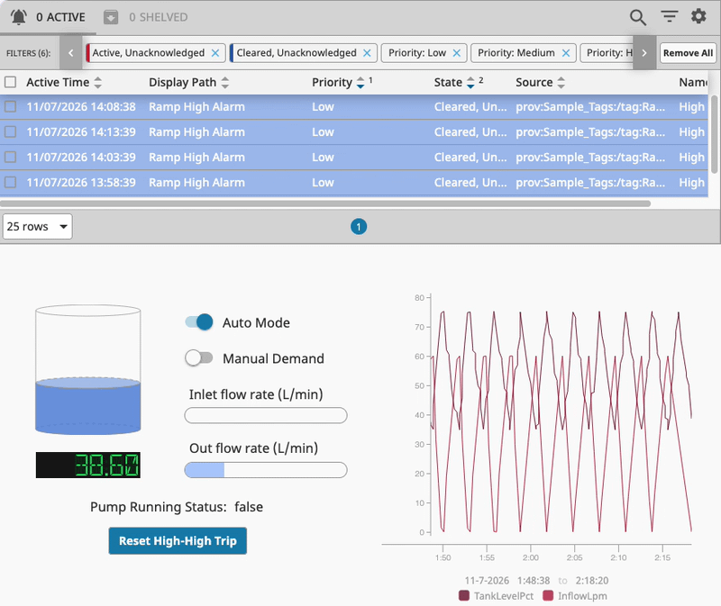
</a>

## Factory Acceptance Test (FAT)
**Plan ID:** FAT  
**Revision:** 0.1  
**Planned Tests and Results**

| ID | Setup / Action | Expected Result | Status | Screenshot Evidence |
|---|---|---|---|---|
| FAT01 | Auto mode, level=34%, pump off; resume | Pump starts within a tick |  | <a href="./assets/screenshots/FAT01.png">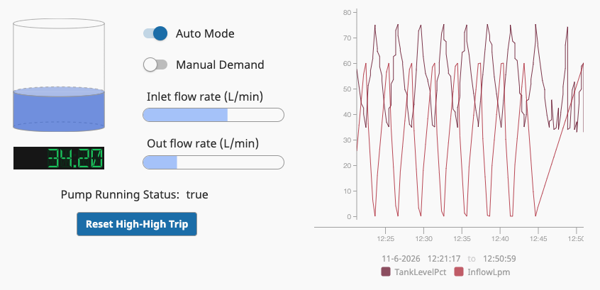</a> |
| FAT02 | Auto mode, level=76%, pump on; resume | Pump stops within a tick |  | <a href="./assets/screenshots/FAT02.png">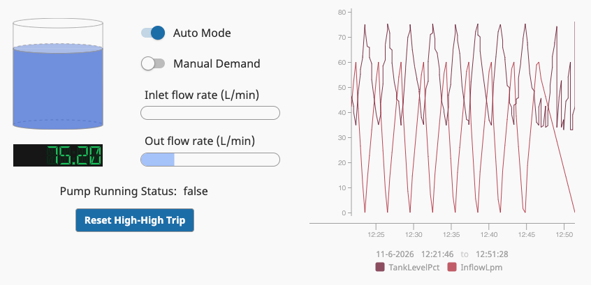</a> |
| FAT03 | Auto mode, level=50%, pump on | Pump remains on (hysteresis) |  | <a href="./assets/screenshots/FAT03.png">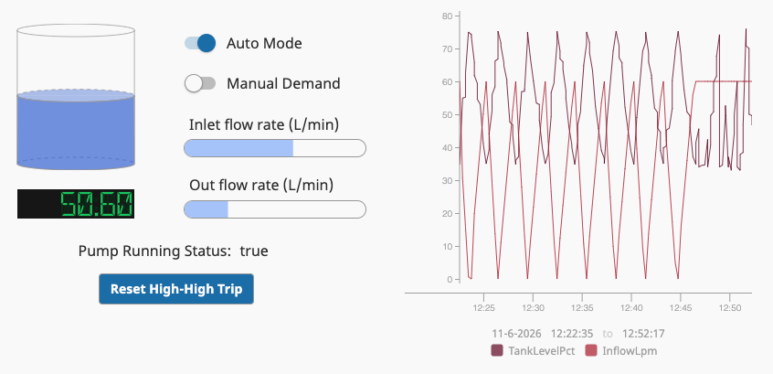</a> |
| FAT04 | Manual mode, level=50%, demand on | Pump runs |  | <a href="./assets/screenshots/FAT04.png"></a> |
| FAT05 | Manual mode, level=50%, demand off | Pump stops |  | <a href="./assets/screenshots/FAT05.png">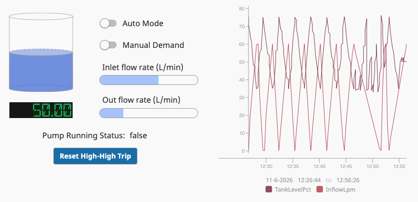</a> |
| FAT06 | Pause and set level=15% | LOW_LEVEL alarm active |  | <a href="./assets/screenshots/FAT06.png">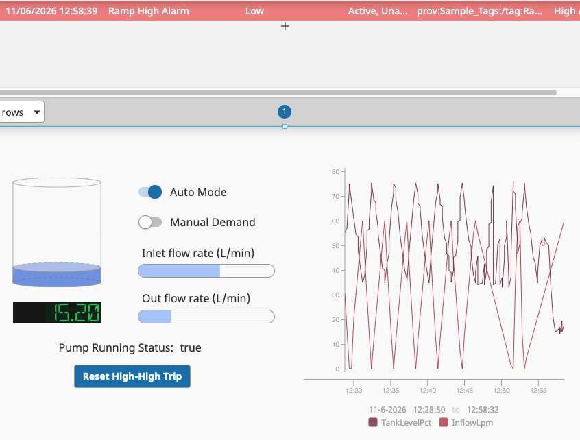</a> |
| FAT07 | Pause and set level=90% | HIGH_LEVEL alarm active |  | <a href="./assets/screenshots/FAT07.png">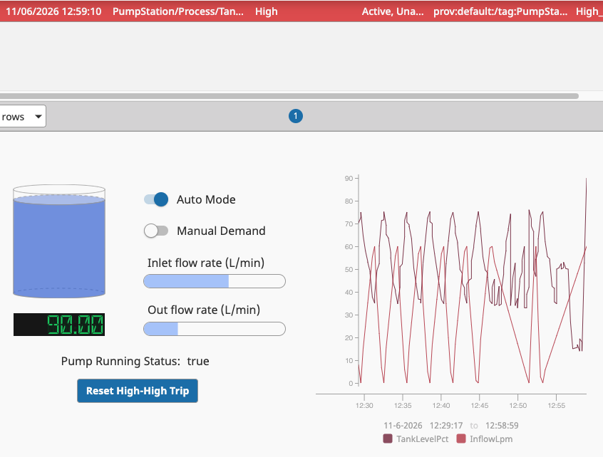</a> |
| FAT08 | Manual mode, demand on, force level=96% | Trip latches and pump stops |  | <a href="./assets/screenshots/FAT08.png">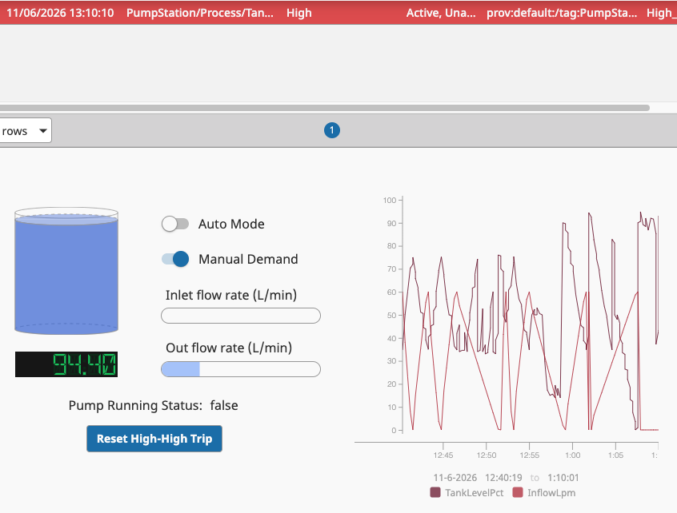</a> |
| FAT09 | With trip latched, level=50% | Pump stays off |  | <a href="./assets/screenshots/FAT09.png">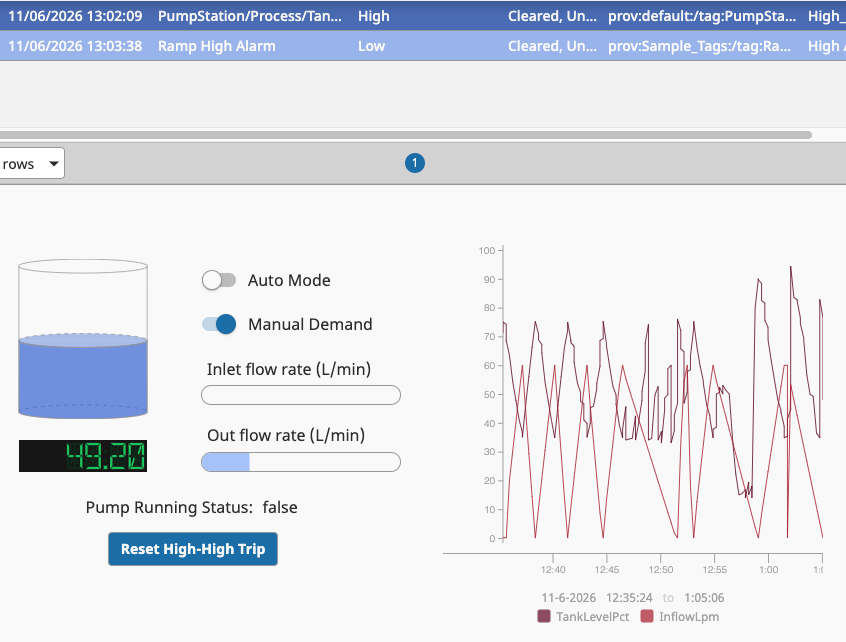</a> |
| FAT10 | Auto mode, level=0% until 75% | No system errors, the tank level reaches 75% and then drops |  | <a href="./assets/screenshots/FAT10.png">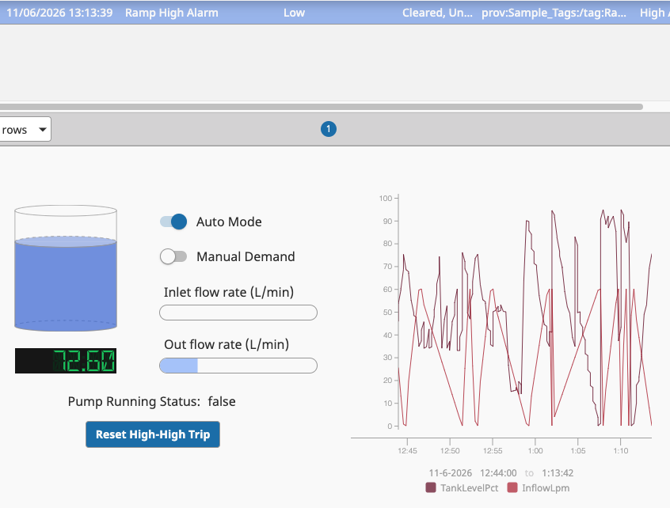</a> |

## Historian Data Validation — PyTest
Automated tests are implemented using **PyTest** to validate historical process measurements exported from the Ignition SCADA historian into `data/tank_level_history.csv`.

The tests verify data availability, measurement validity, data quality, and chronological consistency. They help identify potential issues with the simulation data and historian records before the measurements are used for further analysis.

### Test Cases
| Test | Description | Pass Criteria |
|---|---|---|
| `test_historian_contains_data` | Verifies that the exported historian dataset contains at least one measurement | CSV contains one or more data records |
| `test_tank_levels_within_limits` | Checks that every recorded tank-level measurement falls within the physically valid range | All tank levels are between 0% and 100%, inclusive |
| `test_all_samples_have_good_quality` | Validates the Ignition historian quality code associated with every measurement | All recorded quality codes equal `192` (Good quality in the configured historian schema) |
| `test_timestamps_are_ordered` | Verifies that historical measurements are stored in chronological order | Timestamps are in nondecreasing order, allowing equal timestamps |

### Running the tests
1) Adjust the SQLite database URL in data/data_exporter.py
```python
DB_PATH = Path("YOUR_PATH_HERE.db")
```
2) Export the historian data:
```bash
python3 ./data/data_exporter.py
```
3) Run tests:
```bash
python3 -m pytest ./tests/test_data.py -v
```

### Results
<a href="./assets/screenshots/historian_test_results.png">
  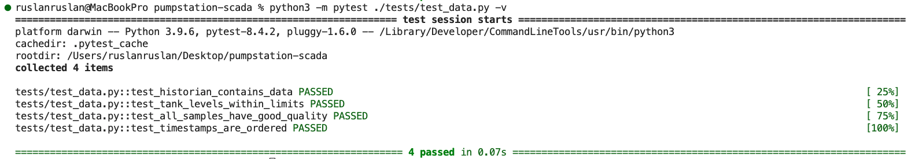
</a>


## Repository map
- `src/ignition/pump_sim.py` — Simulated tank dynamics, automatic pump control, manual operation, and protective interlocks
- `src/ignition/timer_event.py` — Gateway timer script that invokes `pump_sim.tick()` to update the simulation
- `tests/test_timer_event.py` — PyTest regression test verifying that the Gateway timer script contains the required `pump_sim.tick()` call
- `tests/test_historian_data.py` — PyTest validation of historian data availability, measurement limits, quality codes, and timestamp ordering (verify that this file is committed)
- `data/data_exporter.py` — Python 3 script using SQL to extract historical tank-level measurements from the Ignition SQLite database
- `data/tank_level_history.csv` — Exported historical tank-level measurements used for data validation
- `assets/*` — Demonstration and Test Evidence
- `.github/workflows/tests.yml` — GitHub Actions workflow for automated testing on pushes and pull requests


## Technical limitations
The simulation uses a simplified steady-flow water balance with a
nominal 1-second step. Timer jitter, sensor failure, historian scale,
user permissions, communications-loss response, and actual industrial
PLC integration are not validated. Never connect this code to real
process equipment.
